# Database ERD

Generated by `pnpm db:erd` from all committed migrations applied to a fresh, in-process PGlite database. Do not edit by hand.

This is the migrated local schema; live Neon verification is a separate gated step. The Drizzle migration journal is excluded from the domain catalog.

27 tables, 16 enums, 150 constraints, 82 indexes, 11 triggers, 6 trigger functions.

## Relationships

Nullable foreign keys allow zero or one parent. Solid lines identify join-table primary keys; dotted lines are other foreign keys. PK/FK/UK mark column membership; composite and partial uniqueness is defined in the catalog below. SQL types with spaces use underscores in the diagram.

```mermaid
erDiagram
  account_recoveries {
    uuid id PK "required"
    uuid support_case_id FK "required"
    uuid account_id FK "required"
    text old_email "required"
    text new_email "required"
    text code_hmac "required"
    integer attempts "required"
    text status "required"
    boolean unlink_google "required"
    timestamp_with_time_zone expires_at "required"
    uuid created_by_account_id FK "required"
    timestamp_with_time_zone created_at "required"
    timestamp_with_time_zone updated_at "required"
    timestamp_with_time_zone completed_at "nullable"
    timestamp_with_time_zone cancelled_at "nullable"
  }
  accounts {
    uuid id PK "required"
    text name "required"
    text email UK "required"
    boolean email_verified "required"
    text image "nullable"
    account_role role "required"
    timestamp_with_time_zone created_at "required"
    timestamp_with_time_zone updated_at "required"
  }
  activation_credentials {
    uuid id PK "required"
    uuid card_id FK "required"
    product_kind card_kind FK "required"
    text lookup_hmac UK "required"
    timestamp_with_time_zone created_at "required"
    timestamp_with_time_zone used_at "nullable"
    timestamp_with_time_zone revoked_at "nullable"
  }
  activity_events {
    uuid id PK "required"
    text type "required"
    uuid actor_account_id FK "nullable"
    uuid order_id FK "nullable"
    uuid card_id FK "nullable"
    uuid account_id FK "nullable"
    uuid support_case_id FK "nullable"
    uuid stock_purchase_id FK "nullable"
    text note "nullable"
    timestamp_with_time_zone created_at "required"
  }
  auth_identities {
    uuid id PK "required"
    uuid account_id FK "required"
    text provider_account_id UK "required"
    text provider_id UK "required"
    text access_token "nullable"
    text refresh_token "nullable"
    text id_token "nullable"
    timestamp_with_time_zone access_token_expires_at "nullable"
    timestamp_with_time_zone refresh_token_expires_at "nullable"
    text scope "nullable"
    text password "nullable"
    timestamp_with_time_zone created_at "required"
    timestamp_with_time_zone updated_at "required"
  }
  auth_otp_quotas {
    text key PK "required"
    integer count "required"
    timestamp_with_time_zone window_started_at "required"
  }
  auth_rate_limits {
    uuid id PK "required"
    text key UK "required"
    integer count "required"
    bigint last_request "required"
  }
  auth_sessions {
    uuid id PK "required"
    text token UK "required"
    uuid account_id FK "required"
    timestamp_with_time_zone expires_at "required"
    text ip_address "nullable"
    text user_agent "nullable"
    timestamp_with_time_zone created_at "required"
    timestamp_with_time_zone updated_at "required"
  }
  auth_verifications {
    uuid id PK "required"
    text identifier "required"
    text value "required"
    timestamp_with_time_zone expires_at "required"
    timestamp_with_time_zone created_at "required"
    timestamp_with_time_zone updated_at "required"
  }
  cards {
    uuid id PK,UK "required"
    uuid stock_purchase_id FK "required"
    uuid product_id FK "nullable"
    product_kind kind FK,UK "nullable"
    card_state state "required"
    uuid order_item_id FK "nullable"
    text public_token UK "nullable"
    uuid owner_account_id FK "nullable"
    uuid profile_id FK "nullable"
    timestamp_with_time_zone disabled_at "nullable"
    timestamp_with_time_zone created_at "required"
    timestamp_with_time_zone updated_at "required"
    timestamp_with_time_zone nfc_verified_at "nullable"
    timestamp_with_time_zone package_matched_at "nullable"
  }
  expenses {
    uuid id PK "required"
    date spent_on "required"
    integer amount "required"
    expense_category category "required"
    text payee "nullable"
    text note "nullable"
    uuid order_id FK "nullable"
    uuid created_by_account_id FK "required"
    timestamp_with_time_zone created_at "required"
  }
  form_definitions {
    uuid id PK,UK "required"
    uuid profile_id FK,UK "required"
    form_preset preset "required"
    text title "required"
    jsonb config "required"
    timestamp_with_time_zone created_at "required"
    timestamp_with_time_zone updated_at "required"
  }
  form_submissions {
    uuid id PK "required"
    uuid form_id FK,UK "required"
    uuid profile_id FK "required"
    uuid client_key UK "required"
    jsonb answers "required"
    timestamp_with_time_zone created_at "required"
    timestamp_with_time_zone read_at "nullable"
    timestamp_with_time_zone notified_at "nullable"
  }
  order_items {
    uuid id PK,UK "required"
    uuid order_id FK "required"
    uuid product_id FK,UK "required"
    product_kind product_kind FK "required"
    integer quantity "required"
    integer unit_price "required"
    integer agreed_total "nullable"
    text label "nullable"
    text review_url "nullable"
    timestamp_with_time_zone created_at "required"
  }
  orders {
    uuid id PK "required"
    integer number UK "required"
    uuid purchaser_id FK "required"
    order_status status "required"
    delivery_method delivery_method "nullable"
    integer shipping_fee "required"
    text notes "nullable"
    text cancellation_reason "nullable"
    timestamp_with_time_zone completed_at "nullable"
    timestamp_with_time_zone cancelled_at "nullable"
    uuid created_by_account_id FK "required"
    uuid assigned_to_account_id FK "required"
    uuid updated_by_account_id FK "nullable"
    timestamp_with_time_zone created_at "required"
    timestamp_with_time_zone updated_at "required"
  }
  payments {
    uuid id PK "required"
    uuid order_id FK "required"
    integer amount "required"
    payment_method method "required"
    date paid_on "required"
    text reference "nullable"
    uuid recorded_by_account_id FK "required"
    timestamp_with_time_zone created_at "required"
    timestamp_with_time_zone voided_at "nullable"
    uuid voided_by_account_id FK "nullable"
    text void_reason "nullable"
  }
  products {
    uuid id PK,UK "required"
    product_kind kind UK "required"
    text name "required"
    integer price "required"
    boolean active "required"
    timestamp_with_time_zone created_at "required"
    timestamp_with_time_zone updated_at "required"
  }
  profile_links {
    uuid id PK "required"
    uuid profile_id FK "required"
    profile_link_type type "required"
    text label "nullable"
    text url "required"
    integer position "required"
    boolean visible "required"
    timestamp_with_time_zone created_at "required"
  }
  profiles {
    uuid id PK,FK,UK "required"
    uuid account_id FK,UK "required"
    profile_status status "required"
    text full_name "nullable"
    text headline "nullable"
    text company "nullable"
    text bio "nullable"
    text phone "nullable"
    text email "nullable"
    text website "nullable"
    text location "nullable"
    text theme "required"
    text accent_color "nullable"
    text image_asset_id "nullable"
    timestamp_with_time_zone created_at "required"
    timestamp_with_time_zone updated_at "required"
    uuid default_scene_id FK "nullable"
    uuid active_scene_id FK "nullable"
    boolean image_is_logo "required"
    integer content_version "required"
  }
  purchasers {
    uuid id PK "required"
    text name "required"
    text contact_number "nullable"
    timestamp_with_time_zone created_at "required"
    timestamp_with_time_zone updated_at "required"
  }
  refunds {
    uuid id PK "required"
    uuid order_id FK "required"
    integer amount "required"
    payment_method method "required"
    date refunded_on "required"
    text reason "nullable"
    uuid recorded_by_account_id FK "required"
    timestamp_with_time_zone created_at "required"
    uuid support_case_id FK "nullable"
    timestamp_with_time_zone voided_at "nullable"
    uuid voided_by_account_id FK "nullable"
    text void_reason "nullable"
  }
  scene_blocks {
    uuid id PK "required"
    uuid scene_id FK "required"
    block_type type "required"
    integer position "required"
    boolean visible "required"
    jsonb content "required"
    uuid form_id FK "nullable"
    timestamp_with_time_zone created_at "required"
    timestamp_with_time_zone updated_at "required"
  }
  scenes {
    uuid id PK,UK "required"
    uuid profile_id FK,UK "required"
    text name "required"
    timestamp_with_time_zone created_at "required"
    timestamp_with_time_zone updated_at "required"
  }
  shipments {
    uuid id PK "required"
    uuid order_id FK "required"
    text courier "nullable"
    text tracking_number "nullable"
    text recipient_name "nullable"
    text recipient_contact "nullable"
    text address "nullable"
    shipment_status status "required"
    date shipped_on "nullable"
    integer courier_cost "nullable"
    text notes "nullable"
    timestamp_with_time_zone created_at "required"
    timestamp_with_time_zone updated_at "required"
    uuid support_case_id FK "nullable"
  }
  stock_purchases {
    uuid id PK "required"
    text supplier "nullable"
    date received_on "required"
    integer purchase_cost "nullable"
    integer inbound_shipping_cost "nullable"
    text reference "nullable"
    text notes "nullable"
    uuid created_by_account_id FK "required"
    timestamp_with_time_zone created_at "required"
  }
  support_case_cards {
    uuid support_case_id PK,FK "required"
    uuid card_id PK,FK "required"
    support_case_card_role role "required"
    timestamp_with_time_zone created_at "required"
  }
  support_cases {
    uuid id PK "required"
    support_case_type type "required"
    support_case_status status "required"
    text summary "required"
    uuid purchaser_id FK "nullable"
    uuid account_id FK "nullable"
    uuid order_id FK "nullable"
    uuid assigned_to_account_id FK "nullable"
    uuid opened_by_account_id FK "nullable"
    timestamp_with_time_zone created_at "required"
    timestamp_with_time_zone updated_at "required"
    timestamp_with_time_zone resolved_at "nullable"
    support_case_source source "required"
    text requester_email "nullable"
    text requester_name "nullable"
    text requester_message "nullable"
    uuid client_key "nullable"
  }
  accounts ||..o{ account_recoveries : "account_recoveries_account_id_accounts_id_fk"
  accounts ||..o{ account_recoveries : "account_recoveries_created_by_account_id_accounts_id_fk"
  support_cases ||..o{ account_recoveries : "account_recoveries_support_case_id_support_cases_id_fk"
  cards ||..o{ activation_credentials : "activation_credentials_card_fk"
  accounts |o..o{ activity_events : "activity_events_account_id_accounts_id_fk"
  accounts |o..o{ activity_events : "activity_events_actor_account_id_accounts_id_fk"
  cards |o..o{ activity_events : "activity_events_card_id_cards_id_fk"
  orders |o..o{ activity_events : "activity_events_order_id_orders_id_fk"
  stock_purchases |o..o{ activity_events : "activity_events_stock_purchase_id_stock_purchases_id_fk"
  support_cases |o..o{ activity_events : "activity_events_support_case_id_support_cases_id_fk"
  accounts ||..o{ auth_identities : "auth_identities_account_id_accounts_id_fk"
  accounts ||..o{ auth_sessions : "auth_sessions_account_id_accounts_id_fk"
  order_items |o..o{ cards : "cards_order_item_fk"
  accounts |o..o{ cards : "cards_owner_account_id_accounts_id_fk"
  products |o..o{ cards : "cards_product_fk"
  profiles |o..o{ cards : "cards_profile_owner_fk"
  stock_purchases ||..o{ cards : "cards_stock_purchase_id_stock_purchases_id_fk"
  accounts ||..o{ expenses : "expenses_created_by_account_id_accounts_id_fk"
  orders |o..o{ expenses : "expenses_order_id_orders_id_fk"
  profiles ||..o{ form_definitions : "form_definitions_profile_id_profiles_id_fk"
  form_definitions ||..o{ form_submissions : "form_submissions_form_fk"
  orders ||..o{ order_items : "order_items_order_id_orders_id_fk"
  products ||..o{ order_items : "order_items_product_fk"
  accounts ||..o{ orders : "orders_assigned_to_account_id_accounts_id_fk"
  accounts ||..o{ orders : "orders_created_by_account_id_accounts_id_fk"
  purchasers ||..o{ orders : "orders_purchaser_id_purchasers_id_fk"
  accounts |o..o{ orders : "orders_updated_by_account_id_accounts_id_fk"
  orders ||..o{ payments : "payments_order_id_orders_id_fk"
  accounts ||..o{ payments : "payments_recorded_by_account_id_accounts_id_fk"
  accounts |o..o{ payments : "payments_voided_by_account_id_accounts_id_fk"
  profiles ||..o{ profile_links : "profile_links_profile_id_profiles_id_fk"
  accounts ||..o{ profiles : "profiles_account_id_accounts_id_fk"
  scenes |o..o{ profiles : "profiles_active_scene_fk"
  scenes |o..o{ profiles : "profiles_default_scene_fk"
  orders ||..o{ refunds : "refunds_order_id_orders_id_fk"
  accounts ||..o{ refunds : "refunds_recorded_by_account_id_accounts_id_fk"
  support_cases |o..o{ refunds : "refunds_support_case_id_support_cases_id_fk"
  accounts |o..o{ refunds : "refunds_voided_by_account_id_accounts_id_fk"
  form_definitions |o..o{ scene_blocks : "scene_blocks_form_id_form_definitions_id_fk"
  scenes ||..o{ scene_blocks : "scene_blocks_scene_id_scenes_id_fk"
  profiles ||..o{ scenes : "scenes_profile_id_profiles_id_fk"
  orders ||..o{ shipments : "shipments_order_id_orders_id_fk"
  support_cases |o..o{ shipments : "shipments_support_case_id_support_cases_id_fk"
  accounts ||..o{ stock_purchases : "stock_purchases_created_by_account_id_accounts_id_fk"
  cards ||--o{ support_case_cards : "support_case_cards_card_id_cards_id_fk"
  support_cases ||--o{ support_case_cards : "support_case_cards_support_case_id_support_cases_id_fk"
  accounts |o..o{ support_cases : "support_cases_account_id_accounts_id_fk"
  accounts |o..o{ support_cases : "support_cases_assigned_to_account_id_accounts_id_fk"
  accounts |o..o{ support_cases : "support_cases_opened_by_account_id_accounts_id_fk"
  orders |o..o{ support_cases : "support_cases_order_id_orders_id_fk"
  purchasers |o..o{ support_cases : "support_cases_purchaser_id_purchasers_id_fk"
```



## Enums

| Enum | Values |
|---|---|
| `account_role` | `customer`, `owner` |
| `block_type` | `about`, `project`, `link`, `contact`, `booking`, `form` |
| `card_state` | `blank`, `ready`, `reserved`, `released`, `retired` |
| `delivery_method` | `pickup`, `local_handoff`, `courier` |
| `expense_category` | `inventory_production`, `shipping_delivery`, `packaging_printing`, `software_operations`, `marketing`, `other` |
| `form_preset` | `connect`, `project_inquiry`, `contact` |
| `order_status` | `in_progress`, `completed`, `cancelled` |
| `payment_method` | `gcash`, `bank_transfer`, `cash` |
| `product_kind` | `dbc`, `grc` |
| `profile_link_type` | `facebook`, `instagram`, `tiktok`, `linkedin`, `youtube`, `github`, `messenger`, `whatsapp`, `viber`, `telegram`, `x`, `portfolio`, `booking`, `shop`, `menu`, `custom` |
| `profile_status` | `draft`, `published`, `unpublished` |
| `shipment_status` | `pending`, `in_transit`, `delivered`, `failed`, `returned`, `lost` |
| `support_case_card_role` | `affected`, `replacement` |
| `support_case_source` | `owner`, `public`, `account` |
| `support_case_status` | `open`, `waiting_on_customer`, `resolved` |
| `support_case_type` | `activation_issue`, `account_recovery`, `ownership_correction`, `defective_card`, `shipping_issue`, `replacement`, `other` |

## Table catalog

Foreign keys without an explicit delete action use PostgreSQL's `NO ACTION` default. All current foreign keys are non-deferrable, so these prevent orphaned history at statement end. Only auth identities/sessions and profile links use `CASCADE`.

### account_recoveries

| Column | SQL type | Nullable | Default / identity |
|---|---|---|---|
| `id` | `uuid` | no | `gen_random_uuid()` |
| `support_case_id` | `uuid` | no | — |
| `account_id` | `uuid` | no | — |
| `old_email` | `text` | no | — |
| `new_email` | `text` | no | — |
| `code_hmac` | `text` | no | — |
| `attempts` | `integer` | no | `0` |
| `status` | `text` | no | `'pending'::text` |
| `unlink_google` | `boolean` | no | `true` |
| `expires_at` | `timestamp with time zone` | no | — |
| `created_by_account_id` | `uuid` | no | — |
| `created_at` | `timestamp with time zone` | no | `now()` |
| `updated_at` | `timestamp with time zone` | no | `now()` |
| `completed_at` | `timestamp with time zone` | yes | — |
| `cancelled_at` | `timestamp with time zone` | yes | — |

| Constraint | Kind | Definition |
|---|---|---|
| `account_recoveries_account_id_accounts_id_fk` | Foreign key | `FOREIGN KEY (account_id) REFERENCES accounts(id)` |
| `account_recoveries_attempts` | Check | `CHECK (attempts >= 0 AND attempts <= 3)` |
| `account_recoveries_code_hmac` | Check | `CHECK (code_hmac ~ '^[0-9a-f]{64}$'::text)` |
| `account_recoveries_created_by_account_id_accounts_id_fk` | Foreign key | `FOREIGN KEY (created_by_account_id) REFERENCES accounts(id)` |
| `account_recoveries_new_email` | Check | `CHECK (new_email = lower(new_email) AND length(new_email) <= 254)` |
| `account_recoveries_pkey` | Primary key | `PRIMARY KEY (id)` |
| `account_recoveries_status` | Check | `CHECK (status = ANY (ARRAY['pending'::text, 'completed'::text, 'cancelled'::text]))` |
| `account_recoveries_support_case_id_support_cases_id_fk` | Foreign key | `FOREIGN KEY (support_case_id) REFERENCES support_cases(id)` |

| Index | Definition |
|---|---|
| `account_recoveries_pending_account_unique` | `CREATE UNIQUE INDEX account_recoveries_pending_account_unique ON public.account_recoveries USING btree (account_id) WHERE (status = 'pending'::text)` |
| `account_recoveries_pending_email_unique` | `CREATE UNIQUE INDEX account_recoveries_pending_email_unique ON public.account_recoveries USING btree (new_email) WHERE (status = 'pending'::text)` |
| `account_recoveries_pkey` | `CREATE UNIQUE INDEX account_recoveries_pkey ON public.account_recoveries USING btree (id)` |

| Trigger | Definition |
|---|---|
| `account_recoveries_guard` | `CREATE TRIGGER account_recoveries_guard BEFORE DELETE OR UPDATE ON account_recoveries FOR EACH ROW EXECUTE FUNCTION account_recoveries_guard()` |

### accounts

| Column | SQL type | Nullable | Default / identity |
|---|---|---|---|
| `id` | `uuid` | no | `gen_random_uuid()` |
| `name` | `text` | no | — |
| `email` | `text` | no | — |
| `email_verified` | `boolean` | no | `false` |
| `image` | `text` | yes | — |
| `role` | `account_role` | no | `'customer'::account_role` |
| `created_at` | `timestamp with time zone` | no | `now()` |
| `updated_at` | `timestamp with time zone` | no | `now()` |

| Constraint | Kind | Definition |
|---|---|---|
| `accounts_email_unique` | Unique | `UNIQUE (email)` |
| `accounts_pkey` | Primary key | `PRIMARY KEY (id)` |

| Index | Definition |
|---|---|
| `accounts_email_unique` | `CREATE UNIQUE INDEX accounts_email_unique ON public.accounts USING btree (email)` |
| `accounts_pkey` | `CREATE UNIQUE INDEX accounts_pkey ON public.accounts USING btree (id)` |

### activation_credentials

| Column | SQL type | Nullable | Default / identity |
|---|---|---|---|
| `id` | `uuid` | no | `gen_random_uuid()` |
| `card_id` | `uuid` | no | — |
| `card_kind` | `product_kind` | no | `'dbc'::product_kind` |
| `lookup_hmac` | `text` | no | — |
| `created_at` | `timestamp with time zone` | no | `now()` |
| `used_at` | `timestamp with time zone` | yes | — |
| `revoked_at` | `timestamp with time zone` | yes | — |

| Constraint | Kind | Definition |
|---|---|---|
| `activation_credentials_card_fk` | Foreign key | `FOREIGN KEY (card_id, card_kind) REFERENCES cards(id, kind)` |
| `activation_credentials_dbc_only` | Check | `CHECK (card_kind = 'dbc'::product_kind)` |
| `activation_credentials_lookup_hmac_format` | Check | `CHECK (lookup_hmac ~ '^[0-9a-f]{64}$'::text)` |
| `activation_credentials_lookup_hmac_unique` | Unique | `UNIQUE (lookup_hmac)` |
| `activation_credentials_pkey` | Primary key | `PRIMARY KEY (id)` |
| `activation_credentials_single_outcome` | Check | `CHECK (used_at IS NULL OR revoked_at IS NULL)` |

| Index | Definition |
|---|---|
| `activation_credentials_lookup_hmac_unique` | `CREATE UNIQUE INDEX activation_credentials_lookup_hmac_unique ON public.activation_credentials USING btree (lookup_hmac)` |
| `activation_credentials_one_usable_per_card` | `CREATE UNIQUE INDEX activation_credentials_one_usable_per_card ON public.activation_credentials USING btree (card_id) WHERE ((used_at IS NULL) AND (revoked_at IS NULL))` |
| `activation_credentials_pkey` | `CREATE UNIQUE INDEX activation_credentials_pkey ON public.activation_credentials USING btree (id)` |

| Trigger | Definition |
|---|---|
| `activation_credentials_guard` | `CREATE TRIGGER activation_credentials_guard BEFORE INSERT OR DELETE OR UPDATE ON activation_credentials FOR EACH ROW EXECUTE FUNCTION activation_credentials_guard()` |

### activity_events

| Column | SQL type | Nullable | Default / identity |
|---|---|---|---|
| `id` | `uuid` | no | `gen_random_uuid()` |
| `type` | `text` | no | — |
| `actor_account_id` | `uuid` | yes | — |
| `order_id` | `uuid` | yes | — |
| `card_id` | `uuid` | yes | — |
| `account_id` | `uuid` | yes | — |
| `support_case_id` | `uuid` | yes | — |
| `stock_purchase_id` | `uuid` | yes | — |
| `note` | `text` | yes | — |
| `created_at` | `timestamp with time zone` | no | `now()` |

| Constraint | Kind | Definition |
|---|---|---|
| `activity_events_account_id_accounts_id_fk` | Foreign key | `FOREIGN KEY (account_id) REFERENCES accounts(id)` |
| `activity_events_actor_account_id_accounts_id_fk` | Foreign key | `FOREIGN KEY (actor_account_id) REFERENCES accounts(id)` |
| `activity_events_card_id_cards_id_fk` | Foreign key | `FOREIGN KEY (card_id) REFERENCES cards(id)` |
| `activity_events_has_subject` | Check | `CHECK (num_nonnulls(order_id, card_id, account_id, support_case_id, stock_purchase_id) >= 1)` |
| `activity_events_order_id_orders_id_fk` | Foreign key | `FOREIGN KEY (order_id) REFERENCES orders(id)` |
| `activity_events_pkey` | Primary key | `PRIMARY KEY (id)` |
| `activity_events_stock_purchase_id_stock_purchases_id_fk` | Foreign key | `FOREIGN KEY (stock_purchase_id) REFERENCES stock_purchases(id)` |
| `activity_events_support_case_id_support_cases_id_fk` | Foreign key | `FOREIGN KEY (support_case_id) REFERENCES support_cases(id)` |

| Index | Definition |
|---|---|
| `activity_events_account_id_idx` | `CREATE INDEX activity_events_account_id_idx ON public.activity_events USING btree (account_id, created_at) WHERE (account_id IS NOT NULL)` |
| `activity_events_card_id_idx` | `CREATE INDEX activity_events_card_id_idx ON public.activity_events USING btree (card_id, created_at) WHERE (card_id IS NOT NULL)` |
| `activity_events_created_at_idx` | `CREATE INDEX activity_events_created_at_idx ON public.activity_events USING btree (created_at DESC NULLS LAST)` |
| `activity_events_order_id_idx` | `CREATE INDEX activity_events_order_id_idx ON public.activity_events USING btree (order_id, created_at) WHERE (order_id IS NOT NULL)` |
| `activity_events_pkey` | `CREATE UNIQUE INDEX activity_events_pkey ON public.activity_events USING btree (id)` |
| `activity_events_support_case_id_idx` | `CREATE INDEX activity_events_support_case_id_idx ON public.activity_events USING btree (support_case_id, created_at) WHERE (support_case_id IS NOT NULL)` |

| Trigger | Definition |
|---|---|
| `activity_events_history_guard` | `CREATE TRIGGER activity_events_history_guard BEFORE DELETE OR UPDATE ON activity_events FOR EACH ROW EXECUTE FUNCTION history_guard()` |

### auth_identities

| Column | SQL type | Nullable | Default / identity |
|---|---|---|---|
| `id` | `uuid` | no | `gen_random_uuid()` |
| `account_id` | `uuid` | no | — |
| `provider_account_id` | `text` | no | — |
| `provider_id` | `text` | no | — |
| `access_token` | `text` | yes | — |
| `refresh_token` | `text` | yes | — |
| `id_token` | `text` | yes | — |
| `access_token_expires_at` | `timestamp with time zone` | yes | — |
| `refresh_token_expires_at` | `timestamp with time zone` | yes | — |
| `scope` | `text` | yes | — |
| `password` | `text` | yes | — |
| `created_at` | `timestamp with time zone` | no | `now()` |
| `updated_at` | `timestamp with time zone` | no | `now()` |

| Constraint | Kind | Definition |
|---|---|---|
| `auth_identities_account_id_accounts_id_fk` | Foreign key | `FOREIGN KEY (account_id) REFERENCES accounts(id) ON DELETE CASCADE` |
| `auth_identities_pkey` | Primary key | `PRIMARY KEY (id)` |

| Index | Definition |
|---|---|
| `auth_identities_account_id_idx` | `CREATE INDEX auth_identities_account_id_idx ON public.auth_identities USING btree (account_id)` |
| `auth_identities_pkey` | `CREATE UNIQUE INDEX auth_identities_pkey ON public.auth_identities USING btree (id)` |
| `auth_identities_provider_identity_unique` | `CREATE UNIQUE INDEX auth_identities_provider_identity_unique ON public.auth_identities USING btree (provider_id, provider_account_id)` |

### auth_otp_quotas

| Column | SQL type | Nullable | Default / identity |
|---|---|---|---|
| `key` | `text` | no | — |
| `count` | `integer` | no | — |
| `window_started_at` | `timestamp with time zone` | no | — |

| Constraint | Kind | Definition |
|---|---|---|
| `auth_otp_quotas_count_positive` | Check | `CHECK (count > 0)` |
| `auth_otp_quotas_key_hash` | Check | `CHECK (key ~ '^[0-9a-f]{64}$'::text)` |
| `auth_otp_quotas_pkey` | Primary key | `PRIMARY KEY (key)` |

| Index | Definition |
|---|---|
| `auth_otp_quotas_pkey` | `CREATE UNIQUE INDEX auth_otp_quotas_pkey ON public.auth_otp_quotas USING btree (key)` |

### auth_rate_limits

| Column | SQL type | Nullable | Default / identity |
|---|---|---|---|
| `id` | `uuid` | no | `gen_random_uuid()` |
| `key` | `text` | no | — |
| `count` | `integer` | no | — |
| `last_request` | `bigint` | no | — |

| Constraint | Kind | Definition |
|---|---|---|
| `auth_rate_limits_key_unique` | Unique | `UNIQUE (key)` |
| `auth_rate_limits_pkey` | Primary key | `PRIMARY KEY (id)` |

| Index | Definition |
|---|---|
| `auth_rate_limits_key_unique` | `CREATE UNIQUE INDEX auth_rate_limits_key_unique ON public.auth_rate_limits USING btree (key)` |
| `auth_rate_limits_last_request_idx` | `CREATE INDEX auth_rate_limits_last_request_idx ON public.auth_rate_limits USING btree (last_request)` |
| `auth_rate_limits_pkey` | `CREATE UNIQUE INDEX auth_rate_limits_pkey ON public.auth_rate_limits USING btree (id)` |

### auth_sessions

| Column | SQL type | Nullable | Default / identity |
|---|---|---|---|
| `id` | `uuid` | no | `gen_random_uuid()` |
| `token` | `text` | no | — |
| `account_id` | `uuid` | no | — |
| `expires_at` | `timestamp with time zone` | no | — |
| `ip_address` | `text` | yes | — |
| `user_agent` | `text` | yes | — |
| `created_at` | `timestamp with time zone` | no | `now()` |
| `updated_at` | `timestamp with time zone` | no | `now()` |

| Constraint | Kind | Definition |
|---|---|---|
| `auth_sessions_account_id_accounts_id_fk` | Foreign key | `FOREIGN KEY (account_id) REFERENCES accounts(id) ON DELETE CASCADE` |
| `auth_sessions_pkey` | Primary key | `PRIMARY KEY (id)` |
| `auth_sessions_token_unique` | Unique | `UNIQUE (token)` |

| Index | Definition |
|---|---|
| `auth_sessions_account_id_idx` | `CREATE INDEX auth_sessions_account_id_idx ON public.auth_sessions USING btree (account_id)` |
| `auth_sessions_pkey` | `CREATE UNIQUE INDEX auth_sessions_pkey ON public.auth_sessions USING btree (id)` |
| `auth_sessions_token_unique` | `CREATE UNIQUE INDEX auth_sessions_token_unique ON public.auth_sessions USING btree (token)` |

### auth_verifications

| Column | SQL type | Nullable | Default / identity |
|---|---|---|---|
| `id` | `uuid` | no | `gen_random_uuid()` |
| `identifier` | `text` | no | — |
| `value` | `text` | no | — |
| `expires_at` | `timestamp with time zone` | no | — |
| `created_at` | `timestamp with time zone` | no | `now()` |
| `updated_at` | `timestamp with time zone` | no | `now()` |

| Constraint | Kind | Definition |
|---|---|---|
| `auth_verifications_pkey` | Primary key | `PRIMARY KEY (id)` |

| Index | Definition |
|---|---|
| `auth_verifications_identifier_idx` | `CREATE INDEX auth_verifications_identifier_idx ON public.auth_verifications USING btree (identifier)` |
| `auth_verifications_pkey` | `CREATE UNIQUE INDEX auth_verifications_pkey ON public.auth_verifications USING btree (id)` |

### cards

| Column | SQL type | Nullable | Default / identity |
|---|---|---|---|
| `id` | `uuid` | no | `gen_random_uuid()` |
| `stock_purchase_id` | `uuid` | no | — |
| `product_id` | `uuid` | yes | — |
| `kind` | `product_kind` | yes | — |
| `state` | `card_state` | no | `'blank'::card_state` |
| `order_item_id` | `uuid` | yes | — |
| `public_token` | `text` | yes | — |
| `owner_account_id` | `uuid` | yes | — |
| `profile_id` | `uuid` | yes | — |
| `disabled_at` | `timestamp with time zone` | yes | — |
| `created_at` | `timestamp with time zone` | no | `now()` |
| `updated_at` | `timestamp with time zone` | no | `now()` |
| `nfc_verified_at` | `timestamp with time zone` | yes | — |
| `package_matched_at` | `timestamp with time zone` | yes | — |

| Constraint | Kind | Definition |
|---|---|---|
| `cards_committed_states_need_product` | Check | `CHECK ((state = ANY (ARRAY['blank'::card_state, 'retired'::card_state])) OR product_id IS NOT NULL)` |
| `cards_dbc_only_fields` | Check | `CHECK (COALESCE(kind = 'dbc'::product_kind, false) OR public_token IS NULL AND owner_account_id IS NULL AND profile_id IS NULL AND disabled_at IS NULL)` |
| `cards_dbc_ready_checks_recorded` | Check | `CHECK (kind IS DISTINCT FROM 'dbc'::product_kind OR state <> 'ready'::card_state OR nfc_verified_at IS NOT NULL AND package_matched_at IS NOT NULL)` |
| `cards_dbc_token_when_provisioned` | Check | `CHECK (kind IS DISTINCT FROM 'dbc'::product_kind OR (state = ANY (ARRAY['blank'::card_state, 'retired'::card_state])) OR public_token IS NOT NULL)` |
| `cards_disabled_needs_owner` | Check | `CHECK (disabled_at IS NULL OR owner_account_id IS NOT NULL)` |
| `cards_fulfillment_needs_order_item` | Check | `CHECK ((state <> ALL (ARRAY['reserved'::card_state, 'released'::card_state])) OR order_item_id IS NOT NULL)` |
| `cards_grc_never_ready` | Check | `CHECK (NOT COALESCE(kind = 'grc'::product_kind AND state = 'ready'::card_state, false))` |
| `cards_id_kind_unique` | Unique | `UNIQUE (id, kind)` |
| `cards_order_item_fk` | Foreign key | `FOREIGN KEY (order_item_id, product_id) REFERENCES order_items(id, product_id)` |
| `cards_order_item_needs_product` | Check | `CHECK (order_item_id IS NULL OR product_id IS NOT NULL)` |
| `cards_owner_account_id_accounts_id_fk` | Foreign key | `FOREIGN KEY (owner_account_id) REFERENCES accounts(id)` |
| `cards_owner_only_after_sale` | Check | `CHECK (owner_account_id IS NULL OR (state = ANY (ARRAY['released'::card_state, 'retired'::card_state])))` |
| `cards_pkey` | Primary key | `PRIMARY KEY (id)` |
| `cards_product_fk` | Foreign key | `FOREIGN KEY (product_id, kind) REFERENCES products(id, kind)` |
| `cards_product_kind_together` | Check | `CHECK ((product_id IS NULL) = (kind IS NULL))` |
| `cards_profile_needs_owner` | Check | `CHECK (profile_id IS NULL OR owner_account_id IS NOT NULL)` |
| `cards_profile_owner_fk` | Foreign key | `FOREIGN KEY (profile_id, owner_account_id) REFERENCES profiles(id, account_id)` |
| `cards_public_token_unique` | Unique | `UNIQUE (public_token)` |
| `cards_retired_routes_nowhere` | Check | `CHECK (state <> 'retired'::card_state OR profile_id IS NULL)` |
| `cards_stock_has_no_order_item` | Check | `CHECK ((state <> ALL (ARRAY['blank'::card_state, 'ready'::card_state])) OR order_item_id IS NULL)` |
| `cards_stock_purchase_id_stock_purchases_id_fk` | Foreign key | `FOREIGN KEY (stock_purchase_id) REFERENCES stock_purchases(id)` |

| Index | Definition |
|---|---|
| `cards_id_kind_unique` | `CREATE UNIQUE INDEX cards_id_kind_unique ON public.cards USING btree (id, kind)` |
| `cards_kind_state_idx` | `CREATE INDEX cards_kind_state_idx ON public.cards USING btree (kind, state)` |
| `cards_order_item_id_idx` | `CREATE INDEX cards_order_item_id_idx ON public.cards USING btree (order_item_id) WHERE (order_item_id IS NOT NULL)` |
| `cards_owner_account_id_idx` | `CREATE INDEX cards_owner_account_id_idx ON public.cards USING btree (owner_account_id) WHERE (owner_account_id IS NOT NULL)` |
| `cards_pkey` | `CREATE UNIQUE INDEX cards_pkey ON public.cards USING btree (id)` |
| `cards_profile_id_idx` | `CREATE INDEX cards_profile_id_idx ON public.cards USING btree (profile_id) WHERE (profile_id IS NOT NULL)` |
| `cards_public_token_unique` | `CREATE UNIQUE INDEX cards_public_token_unique ON public.cards USING btree (public_token)` |
| `cards_stock_purchase_id_idx` | `CREATE INDEX cards_stock_purchase_id_idx ON public.cards USING btree (stock_purchase_id)` |

| Trigger | Definition |
|---|---|
| `cards_guard` | `CREATE TRIGGER cards_guard BEFORE DELETE OR UPDATE ON cards FOR EACH ROW EXECUTE FUNCTION cards_guard()` |

### expenses

| Column | SQL type | Nullable | Default / identity |
|---|---|---|---|
| `id` | `uuid` | no | `gen_random_uuid()` |
| `spent_on` | `date` | no | — |
| `amount` | `integer` | no | — |
| `category` | `expense_category` | no | — |
| `payee` | `text` | yes | — |
| `note` | `text` | yes | — |
| `order_id` | `uuid` | yes | — |
| `created_by_account_id` | `uuid` | no | — |
| `created_at` | `timestamp with time zone` | no | `now()` |

| Constraint | Kind | Definition |
|---|---|---|
| `expenses_amount_positive` | Check | `CHECK (amount > 0)` |
| `expenses_created_by_account_id_accounts_id_fk` | Foreign key | `FOREIGN KEY (created_by_account_id) REFERENCES accounts(id)` |
| `expenses_order_id_orders_id_fk` | Foreign key | `FOREIGN KEY (order_id) REFERENCES orders(id)` |
| `expenses_pkey` | Primary key | `PRIMARY KEY (id)` |

| Index | Definition |
|---|---|
| `expenses_order_id_idx` | `CREATE INDEX expenses_order_id_idx ON public.expenses USING btree (order_id) WHERE (order_id IS NOT NULL)` |
| `expenses_pkey` | `CREATE UNIQUE INDEX expenses_pkey ON public.expenses USING btree (id)` |
| `expenses_spent_on_idx` | `CREATE INDEX expenses_spent_on_idx ON public.expenses USING btree (spent_on)` |

### form_definitions

| Column | SQL type | Nullable | Default / identity |
|---|---|---|---|
| `id` | `uuid` | no | `gen_random_uuid()` |
| `profile_id` | `uuid` | no | — |
| `preset` | `form_preset` | no | — |
| `title` | `text` | no | — |
| `config` | `jsonb` | no | — |
| `created_at` | `timestamp with time zone` | no | `now()` |
| `updated_at` | `timestamp with time zone` | no | `now()` |

| Constraint | Kind | Definition |
|---|---|---|
| `form_definitions_config_object` | Check | `CHECK (jsonb_typeof(config) = 'object'::text)` |
| `form_definitions_id_profile_unique` | Unique | `UNIQUE (id, profile_id)` |
| `form_definitions_pkey` | Primary key | `PRIMARY KEY (id)` |
| `form_definitions_profile_id_profiles_id_fk` | Foreign key | `FOREIGN KEY (profile_id) REFERENCES profiles(id) ON DELETE CASCADE` |
| `form_definitions_title_length` | Check | `CHECK (char_length(title) >= 1 AND char_length(title) <= 60)` |

| Index | Definition |
|---|---|
| `form_definitions_id_profile_unique` | `CREATE UNIQUE INDEX form_definitions_id_profile_unique ON public.form_definitions USING btree (id, profile_id)` |
| `form_definitions_pkey` | `CREATE UNIQUE INDEX form_definitions_pkey ON public.form_definitions USING btree (id)` |
| `form_definitions_profile_id_idx` | `CREATE INDEX form_definitions_profile_id_idx ON public.form_definitions USING btree (profile_id)` |

### form_submissions

| Column | SQL type | Nullable | Default / identity |
|---|---|---|---|
| `id` | `uuid` | no | `gen_random_uuid()` |
| `form_id` | `uuid` | no | — |
| `profile_id` | `uuid` | no | — |
| `client_key` | `uuid` | no | — |
| `answers` | `jsonb` | no | — |
| `created_at` | `timestamp with time zone` | no | `now()` |
| `read_at` | `timestamp with time zone` | yes | — |
| `notified_at` | `timestamp with time zone` | yes | — |

| Constraint | Kind | Definition |
|---|---|---|
| `form_submissions_answers_array` | Check | `CHECK (jsonb_typeof(answers) = 'array'::text)` |
| `form_submissions_form_client_key_unique` | Unique | `UNIQUE (form_id, client_key)` |
| `form_submissions_form_fk` | Foreign key | `FOREIGN KEY (form_id, profile_id) REFERENCES form_definitions(id, profile_id) ON DELETE CASCADE` |
| `form_submissions_pkey` | Primary key | `PRIMARY KEY (id)` |

| Index | Definition |
|---|---|
| `form_submissions_form_client_key_unique` | `CREATE UNIQUE INDEX form_submissions_form_client_key_unique ON public.form_submissions USING btree (form_id, client_key)` |
| `form_submissions_pkey` | `CREATE UNIQUE INDEX form_submissions_pkey ON public.form_submissions USING btree (id)` |
| `form_submissions_profile_created_idx` | `CREATE INDEX form_submissions_profile_created_idx ON public.form_submissions USING btree (profile_id, created_at DESC NULLS LAST)` |

### order_items

| Column | SQL type | Nullable | Default / identity |
|---|---|---|---|
| `id` | `uuid` | no | `gen_random_uuid()` |
| `order_id` | `uuid` | no | — |
| `product_id` | `uuid` | no | — |
| `product_kind` | `product_kind` | no | — |
| `quantity` | `integer` | no | — |
| `unit_price` | `integer` | no | — |
| `agreed_total` | `integer` | yes | — |
| `label` | `text` | yes | — |
| `review_url` | `text` | yes | — |
| `created_at` | `timestamp with time zone` | no | `now()` |

| Constraint | Kind | Definition |
|---|---|---|
| `order_items_agreed_total_nonnegative` | Check | `CHECK (agreed_total IS NULL OR agreed_total >= 0)` |
| `order_items_id_product_unique` | Unique | `UNIQUE (id, product_id)` |
| `order_items_order_id_orders_id_fk` | Foreign key | `FOREIGN KEY (order_id) REFERENCES orders(id)` |
| `order_items_pkey` | Primary key | `PRIMARY KEY (id)` |
| `order_items_product_fk` | Foreign key | `FOREIGN KEY (product_id, product_kind) REFERENCES products(id, kind)` |
| `order_items_quantity_positive` | Check | `CHECK (quantity > 0)` |
| `order_items_review_url_grc_https` | Check | `CHECK (review_url IS NULL OR product_kind = 'grc'::product_kind AND review_url ~ '^https://'::text)` |
| `order_items_unit_price_nonnegative` | Check | `CHECK (unit_price >= 0)` |

| Index | Definition |
|---|---|
| `order_items_id_product_unique` | `CREATE UNIQUE INDEX order_items_id_product_unique ON public.order_items USING btree (id, product_id)` |
| `order_items_order_id_idx` | `CREATE INDEX order_items_order_id_idx ON public.order_items USING btree (order_id)` |
| `order_items_pkey` | `CREATE UNIQUE INDEX order_items_pkey ON public.order_items USING btree (id)` |

### orders

| Column | SQL type | Nullable | Default / identity |
|---|---|---|---|
| `id` | `uuid` | no | `gen_random_uuid()` |
| `number` | `integer` | no | `GENERATED ALWAYS AS IDENTITY` |
| `purchaser_id` | `uuid` | no | — |
| `status` | `order_status` | no | `'in_progress'::order_status` |
| `delivery_method` | `delivery_method` | yes | — |
| `shipping_fee` | `integer` | no | `0` |
| `notes` | `text` | yes | — |
| `cancellation_reason` | `text` | yes | — |
| `completed_at` | `timestamp with time zone` | yes | — |
| `cancelled_at` | `timestamp with time zone` | yes | — |
| `created_by_account_id` | `uuid` | no | — |
| `assigned_to_account_id` | `uuid` | no | — |
| `updated_by_account_id` | `uuid` | yes | — |
| `created_at` | `timestamp with time zone` | no | `now()` |
| `updated_at` | `timestamp with time zone` | no | `now()` |

| Constraint | Kind | Definition |
|---|---|---|
| `orders_assigned_to_account_id_accounts_id_fk` | Foreign key | `FOREIGN KEY (assigned_to_account_id) REFERENCES accounts(id)` |
| `orders_cancelled_at_matches_status` | Check | `CHECK ((status = 'cancelled'::order_status) = (cancelled_at IS NOT NULL))` |
| `orders_completed_at_matches_status` | Check | `CHECK ((status = 'completed'::order_status) = (completed_at IS NOT NULL))` |
| `orders_created_by_account_id_accounts_id_fk` | Foreign key | `FOREIGN KEY (created_by_account_id) REFERENCES accounts(id)` |
| `orders_number_unique` | Unique | `UNIQUE (number)` |
| `orders_pkey` | Primary key | `PRIMARY KEY (id)` |
| `orders_purchaser_id_purchasers_id_fk` | Foreign key | `FOREIGN KEY (purchaser_id) REFERENCES purchasers(id)` |
| `orders_shipping_fee_nonnegative` | Check | `CHECK (shipping_fee >= 0)` |
| `orders_updated_by_account_id_accounts_id_fk` | Foreign key | `FOREIGN KEY (updated_by_account_id) REFERENCES accounts(id)` |

| Index | Definition |
|---|---|
| `orders_number_unique` | `CREATE UNIQUE INDEX orders_number_unique ON public.orders USING btree (number)` |
| `orders_pkey` | `CREATE UNIQUE INDEX orders_pkey ON public.orders USING btree (id)` |
| `orders_purchaser_id_idx` | `CREATE INDEX orders_purchaser_id_idx ON public.orders USING btree (purchaser_id)` |
| `orders_status_created_at_idx` | `CREATE INDEX orders_status_created_at_idx ON public.orders USING btree (status, created_at DESC NULLS LAST)` |

| Trigger | Definition |
|---|---|
| `orders_guard` | `CREATE TRIGGER orders_guard BEFORE DELETE OR UPDATE ON orders FOR EACH ROW EXECUTE FUNCTION orders_guard()` |

### payments

| Column | SQL type | Nullable | Default / identity |
|---|---|---|---|
| `id` | `uuid` | no | `gen_random_uuid()` |
| `order_id` | `uuid` | no | — |
| `amount` | `integer` | no | — |
| `method` | `payment_method` | no | — |
| `paid_on` | `date` | no | — |
| `reference` | `text` | yes | — |
| `recorded_by_account_id` | `uuid` | no | — |
| `created_at` | `timestamp with time zone` | no | `now()` |
| `voided_at` | `timestamp with time zone` | yes | — |
| `voided_by_account_id` | `uuid` | yes | — |
| `void_reason` | `text` | yes | — |

| Constraint | Kind | Definition |
|---|---|---|
| `payments_amount_positive` | Check | `CHECK (amount > 0)` |
| `payments_order_id_orders_id_fk` | Foreign key | `FOREIGN KEY (order_id) REFERENCES orders(id)` |
| `payments_pkey` | Primary key | `PRIMARY KEY (id)` |
| `payments_recorded_by_account_id_accounts_id_fk` | Foreign key | `FOREIGN KEY (recorded_by_account_id) REFERENCES accounts(id)` |
| `payments_void_all_or_none` | Check | `CHECK (voided_at IS NULL AND voided_by_account_id IS NULL AND void_reason IS NULL OR voided_at IS NOT NULL AND voided_by_account_id IS NOT NULL AND void_reason IS NOT NULL AND length(TRIM(BOTH FROM void_reason)) > 0)` |
| `payments_voided_by_account_id_accounts_id_fk` | Foreign key | `FOREIGN KEY (voided_by_account_id) REFERENCES accounts(id)` |

| Index | Definition |
|---|---|
| `payments_order_id_idx` | `CREATE INDEX payments_order_id_idx ON public.payments USING btree (order_id)` |
| `payments_pkey` | `CREATE UNIQUE INDEX payments_pkey ON public.payments USING btree (id)` |

| Trigger | Definition |
|---|---|
| `payments_history_guard` | `CREATE TRIGGER payments_history_guard BEFORE DELETE OR UPDATE ON payments FOR EACH ROW EXECUTE FUNCTION history_guard('order_id', 'amount', 'method', 'paid_on', 'recorded_by_account_id', 'created_at')` |
| `payments_void_once_guard` | `CREATE TRIGGER payments_void_once_guard BEFORE UPDATE ON payments FOR EACH ROW EXECUTE FUNCTION void_once_guard()` |

### products

| Column | SQL type | Nullable | Default / identity |
|---|---|---|---|
| `id` | `uuid` | no | `gen_random_uuid()` |
| `kind` | `product_kind` | no | — |
| `name` | `text` | no | — |
| `price` | `integer` | no | — |
| `active` | `boolean` | no | `true` |
| `created_at` | `timestamp with time zone` | no | `now()` |
| `updated_at` | `timestamp with time zone` | no | `now()` |

| Constraint | Kind | Definition |
|---|---|---|
| `products_id_kind_unique` | Unique | `UNIQUE (id, kind)` |
| `products_pkey` | Primary key | `PRIMARY KEY (id)` |
| `products_price_nonnegative` | Check | `CHECK (price >= 0)` |

| Index | Definition |
|---|---|
| `products_id_kind_unique` | `CREATE UNIQUE INDEX products_id_kind_unique ON public.products USING btree (id, kind)` |
| `products_one_active_per_kind` | `CREATE UNIQUE INDEX products_one_active_per_kind ON public.products USING btree (kind) WHERE active` |
| `products_pkey` | `CREATE UNIQUE INDEX products_pkey ON public.products USING btree (id)` |

### profile_links

| Column | SQL type | Nullable | Default / identity |
|---|---|---|---|
| `id` | `uuid` | no | `gen_random_uuid()` |
| `profile_id` | `uuid` | no | — |
| `type` | `profile_link_type` | no | — |
| `label` | `text` | yes | — |
| `url` | `text` | no | — |
| `position` | `integer` | no | `0` |
| `visible` | `boolean` | no | `true` |
| `created_at` | `timestamp with time zone` | no | `now()` |

| Constraint | Kind | Definition |
|---|---|---|
| `profile_links_pkey` | Primary key | `PRIMARY KEY (id)` |
| `profile_links_position_nonnegative` | Check | `CHECK ("position" >= 0)` |
| `profile_links_profile_id_profiles_id_fk` | Foreign key | `FOREIGN KEY (profile_id) REFERENCES profiles(id) ON DELETE CASCADE` |

| Index | Definition |
|---|---|
| `profile_links_pkey` | `CREATE UNIQUE INDEX profile_links_pkey ON public.profile_links USING btree (id)` |
| `profile_links_profile_id_position_idx` | `CREATE INDEX profile_links_profile_id_position_idx ON public.profile_links USING btree (profile_id, "position")` |

### profiles

| Column | SQL type | Nullable | Default / identity |
|---|---|---|---|
| `id` | `uuid` | no | `gen_random_uuid()` |
| `account_id` | `uuid` | no | — |
| `status` | `profile_status` | no | `'draft'::profile_status` |
| `full_name` | `text` | yes | — |
| `headline` | `text` | yes | — |
| `company` | `text` | yes | — |
| `bio` | `text` | yes | — |
| `phone` | `text` | yes | — |
| `email` | `text` | yes | — |
| `website` | `text` | yes | — |
| `location` | `text` | yes | — |
| `theme` | `text` | no | `'default'::text` |
| `accent_color` | `text` | yes | — |
| `image_asset_id` | `text` | yes | — |
| `created_at` | `timestamp with time zone` | no | `now()` |
| `updated_at` | `timestamp with time zone` | no | `now()` |
| `default_scene_id` | `uuid` | yes | — |
| `active_scene_id` | `uuid` | yes | — |
| `image_is_logo` | `boolean` | no | `false` |
| `content_version` | `integer` | no | `0` |

| Constraint | Kind | Definition |
|---|---|---|
| `profiles_accent_color_hex` | Check | `CHECK (accent_color IS NULL OR accent_color ~ '^#[0-9a-fA-F]{6}$'::text)` |
| `profiles_account_id_accounts_id_fk` | Foreign key | `FOREIGN KEY (account_id) REFERENCES accounts(id)` |
| `profiles_active_scene_fk` | Foreign key | `FOREIGN KEY (active_scene_id, id) REFERENCES scenes(id, profile_id)` |
| `profiles_default_scene_fk` | Foreign key | `FOREIGN KEY (default_scene_id, id) REFERENCES scenes(id, profile_id)` |
| `profiles_id_account_unique` | Unique | `UNIQUE (id, account_id)` |
| `profiles_pkey` | Primary key | `PRIMARY KEY (id)` |
| `profiles_published_needs_default_scene` | Check | `CHECK (status <> 'published'::profile_status OR default_scene_id IS NOT NULL)` |
| `profiles_published_needs_name` | Check | `CHECK (status <> 'published'::profile_status OR full_name IS NOT NULL)` |

| Index | Definition |
|---|---|
| `profiles_account_id_idx` | `CREATE INDEX profiles_account_id_idx ON public.profiles USING btree (account_id)` |
| `profiles_id_account_unique` | `CREATE UNIQUE INDEX profiles_id_account_unique ON public.profiles USING btree (id, account_id)` |
| `profiles_pkey` | `CREATE UNIQUE INDEX profiles_pkey ON public.profiles USING btree (id)` |

### purchasers

| Column | SQL type | Nullable | Default / identity |
|---|---|---|---|
| `id` | `uuid` | no | `gen_random_uuid()` |
| `name` | `text` | no | — |
| `contact_number` | `text` | yes | — |
| `created_at` | `timestamp with time zone` | no | `now()` |
| `updated_at` | `timestamp with time zone` | no | `now()` |

| Constraint | Kind | Definition |
|---|---|---|
| `purchasers_pkey` | Primary key | `PRIMARY KEY (id)` |

| Index | Definition |
|---|---|
| `purchasers_pkey` | `CREATE UNIQUE INDEX purchasers_pkey ON public.purchasers USING btree (id)` |

### refunds

| Column | SQL type | Nullable | Default / identity |
|---|---|---|---|
| `id` | `uuid` | no | `gen_random_uuid()` |
| `order_id` | `uuid` | no | — |
| `amount` | `integer` | no | — |
| `method` | `payment_method` | no | — |
| `refunded_on` | `date` | no | — |
| `reason` | `text` | yes | — |
| `recorded_by_account_id` | `uuid` | no | — |
| `created_at` | `timestamp with time zone` | no | `now()` |
| `support_case_id` | `uuid` | yes | — |
| `voided_at` | `timestamp with time zone` | yes | — |
| `voided_by_account_id` | `uuid` | yes | — |
| `void_reason` | `text` | yes | — |

| Constraint | Kind | Definition |
|---|---|---|
| `refunds_amount_positive` | Check | `CHECK (amount > 0)` |
| `refunds_order_id_orders_id_fk` | Foreign key | `FOREIGN KEY (order_id) REFERENCES orders(id)` |
| `refunds_pkey` | Primary key | `PRIMARY KEY (id)` |
| `refunds_recorded_by_account_id_accounts_id_fk` | Foreign key | `FOREIGN KEY (recorded_by_account_id) REFERENCES accounts(id)` |
| `refunds_support_case_id_support_cases_id_fk` | Foreign key | `FOREIGN KEY (support_case_id) REFERENCES support_cases(id)` |
| `refunds_support_reason` | Check | `CHECK (support_case_id IS NULL OR reason IS NOT NULL AND length(TRIM(BOTH FROM reason)) > 0)` |
| `refunds_void_all_or_none` | Check | `CHECK (voided_at IS NULL AND voided_by_account_id IS NULL AND void_reason IS NULL OR voided_at IS NOT NULL AND voided_by_account_id IS NOT NULL AND void_reason IS NOT NULL AND length(TRIM(BOTH FROM void_reason)) > 0)` |
| `refunds_voided_by_account_id_accounts_id_fk` | Foreign key | `FOREIGN KEY (voided_by_account_id) REFERENCES accounts(id)` |

| Index | Definition |
|---|---|
| `refunds_order_id_idx` | `CREATE INDEX refunds_order_id_idx ON public.refunds USING btree (order_id)` |
| `refunds_pkey` | `CREATE UNIQUE INDEX refunds_pkey ON public.refunds USING btree (id)` |

| Trigger | Definition |
|---|---|
| `refunds_history_guard` | `CREATE TRIGGER refunds_history_guard BEFORE DELETE OR UPDATE ON refunds FOR EACH ROW EXECUTE FUNCTION history_guard('order_id', 'amount', 'method', 'refunded_on', 'recorded_by_account_id', 'created_at', 'support_case_id')` |
| `refunds_void_once_guard` | `CREATE TRIGGER refunds_void_once_guard BEFORE UPDATE ON refunds FOR EACH ROW EXECUTE FUNCTION void_once_guard()` |

### scene_blocks

| Column | SQL type | Nullable | Default / identity |
|---|---|---|---|
| `id` | `uuid` | no | `gen_random_uuid()` |
| `scene_id` | `uuid` | no | — |
| `type` | `block_type` | no | — |
| `position` | `integer` | no | — |
| `visible` | `boolean` | no | `true` |
| `content` | `jsonb` | no | `'{}'::jsonb` |
| `form_id` | `uuid` | yes | — |
| `created_at` | `timestamp with time zone` | no | `now()` |
| `updated_at` | `timestamp with time zone` | no | `now()` |

| Constraint | Kind | Definition |
|---|---|---|
| `scene_blocks_content_object` | Check | `CHECK (jsonb_typeof(content) = 'object'::text)` |
| `scene_blocks_form_id_form_definitions_id_fk` | Foreign key | `FOREIGN KEY (form_id) REFERENCES form_definitions(id)` |
| `scene_blocks_form_only_on_form` | Check | `CHECK ((type = 'form'::block_type) = (form_id IS NOT NULL))` |
| `scene_blocks_pkey` | Primary key | `PRIMARY KEY (id)` |
| `scene_blocks_position_nonnegative` | Check | `CHECK ("position" >= 0)` |
| `scene_blocks_scene_id_scenes_id_fk` | Foreign key | `FOREIGN KEY (scene_id) REFERENCES scenes(id) ON DELETE CASCADE` |

| Index | Definition |
|---|---|
| `scene_blocks_form_id_idx` | `CREATE INDEX scene_blocks_form_id_idx ON public.scene_blocks USING btree (form_id) WHERE (form_id IS NOT NULL)` |
| `scene_blocks_pkey` | `CREATE UNIQUE INDEX scene_blocks_pkey ON public.scene_blocks USING btree (id)` |
| `scene_blocks_scene_id_position_idx` | `CREATE INDEX scene_blocks_scene_id_position_idx ON public.scene_blocks USING btree (scene_id, "position")` |

### scenes

| Column | SQL type | Nullable | Default / identity |
|---|---|---|---|
| `id` | `uuid` | no | `gen_random_uuid()` |
| `profile_id` | `uuid` | no | — |
| `name` | `text` | no | — |
| `created_at` | `timestamp with time zone` | no | `now()` |
| `updated_at` | `timestamp with time zone` | no | `now()` |

| Constraint | Kind | Definition |
|---|---|---|
| `scenes_id_profile_unique` | Unique | `UNIQUE (id, profile_id)` |
| `scenes_name_length` | Check | `CHECK (char_length(name) >= 1 AND char_length(name) <= 40)` |
| `scenes_pkey` | Primary key | `PRIMARY KEY (id)` |
| `scenes_profile_id_profiles_id_fk` | Foreign key | `FOREIGN KEY (profile_id) REFERENCES profiles(id) ON DELETE CASCADE` |

| Index | Definition |
|---|---|
| `scenes_id_profile_unique` | `CREATE UNIQUE INDEX scenes_id_profile_unique ON public.scenes USING btree (id, profile_id)` |
| `scenes_pkey` | `CREATE UNIQUE INDEX scenes_pkey ON public.scenes USING btree (id)` |
| `scenes_profile_id_idx` | `CREATE INDEX scenes_profile_id_idx ON public.scenes USING btree (profile_id)` |

### shipments

| Column | SQL type | Nullable | Default / identity |
|---|---|---|---|
| `id` | `uuid` | no | `gen_random_uuid()` |
| `order_id` | `uuid` | no | — |
| `courier` | `text` | yes | — |
| `tracking_number` | `text` | yes | — |
| `recipient_name` | `text` | yes | — |
| `recipient_contact` | `text` | yes | — |
| `address` | `text` | yes | — |
| `status` | `shipment_status` | no | `'pending'::shipment_status` |
| `shipped_on` | `date` | yes | — |
| `courier_cost` | `integer` | yes | — |
| `notes` | `text` | yes | — |
| `created_at` | `timestamp with time zone` | no | `now()` |
| `updated_at` | `timestamp with time zone` | no | `now()` |
| `support_case_id` | `uuid` | yes | — |

| Constraint | Kind | Definition |
|---|---|---|
| `shipments_courier_cost_nonnegative` | Check | `CHECK (courier_cost IS NULL OR courier_cost >= 0)` |
| `shipments_courier_cost_requires_shipped_on` | Check | `CHECK (courier_cost IS NULL OR shipped_on IS NOT NULL)` |
| `shipments_order_id_orders_id_fk` | Foreign key | `FOREIGN KEY (order_id) REFERENCES orders(id)` |
| `shipments_pending_not_shipped` | Check | `CHECK (status <> 'pending'::shipment_status OR shipped_on IS NULL)` |
| `shipments_pkey` | Primary key | `PRIMARY KEY (id)` |
| `shipments_shipped_on_after_pending` | Check | `CHECK ((status = ANY (ARRAY['pending'::shipment_status, 'failed'::shipment_status])) OR shipped_on IS NOT NULL)` |
| `shipments_support_case_id_support_cases_id_fk` | Foreign key | `FOREIGN KEY (support_case_id) REFERENCES support_cases(id)` |

| Index | Definition |
|---|---|
| `shipments_order_id_idx` | `CREATE INDEX shipments_order_id_idx ON public.shipments USING btree (order_id)` |
| `shipments_pkey` | `CREATE UNIQUE INDEX shipments_pkey ON public.shipments USING btree (id)` |

### stock_purchases

| Column | SQL type | Nullable | Default / identity |
|---|---|---|---|
| `id` | `uuid` | no | `gen_random_uuid()` |
| `supplier` | `text` | yes | — |
| `received_on` | `date` | no | — |
| `purchase_cost` | `integer` | yes | — |
| `inbound_shipping_cost` | `integer` | yes | — |
| `reference` | `text` | yes | — |
| `notes` | `text` | yes | — |
| `created_by_account_id` | `uuid` | no | — |
| `created_at` | `timestamp with time zone` | no | `now()` |

| Constraint | Kind | Definition |
|---|---|---|
| `stock_purchases_created_by_account_id_accounts_id_fk` | Foreign key | `FOREIGN KEY (created_by_account_id) REFERENCES accounts(id)` |
| `stock_purchases_inbound_shipping_cost_nonnegative` | Check | `CHECK (inbound_shipping_cost IS NULL OR inbound_shipping_cost >= 0)` |
| `stock_purchases_pkey` | Primary key | `PRIMARY KEY (id)` |
| `stock_purchases_purchase_cost_nonnegative` | Check | `CHECK (purchase_cost IS NULL OR purchase_cost >= 0)` |

| Index | Definition |
|---|---|
| `stock_purchases_pkey` | `CREATE UNIQUE INDEX stock_purchases_pkey ON public.stock_purchases USING btree (id)` |

### support_case_cards

| Column | SQL type | Nullable | Default / identity |
|---|---|---|---|
| `support_case_id` | `uuid` | no | — |
| `card_id` | `uuid` | no | — |
| `role` | `support_case_card_role` | no | — |
| `created_at` | `timestamp with time zone` | no | `now()` |

| Constraint | Kind | Definition |
|---|---|---|
| `support_case_cards_card_id_cards_id_fk` | Foreign key | `FOREIGN KEY (card_id) REFERENCES cards(id)` |
| `support_case_cards_support_case_id_card_id_pk` | Primary key | `PRIMARY KEY (support_case_id, card_id)` |
| `support_case_cards_support_case_id_support_cases_id_fk` | Foreign key | `FOREIGN KEY (support_case_id) REFERENCES support_cases(id)` |

| Index | Definition |
|---|---|
| `support_case_cards_card_id_idx` | `CREATE INDEX support_case_cards_card_id_idx ON public.support_case_cards USING btree (card_id)` |
| `support_case_cards_support_case_id_card_id_pk` | `CREATE UNIQUE INDEX support_case_cards_support_case_id_card_id_pk ON public.support_case_cards USING btree (support_case_id, card_id)` |

| Trigger | Definition |
|---|---|
| `support_case_cards_history_guard` | `CREATE TRIGGER support_case_cards_history_guard BEFORE DELETE OR UPDATE ON support_case_cards FOR EACH ROW EXECUTE FUNCTION history_guard('support_case_id', 'card_id', 'role', 'created_at')` |

### support_cases

| Column | SQL type | Nullable | Default / identity |
|---|---|---|---|
| `id` | `uuid` | no | `gen_random_uuid()` |
| `type` | `support_case_type` | no | — |
| `status` | `support_case_status` | no | `'open'::support_case_status` |
| `summary` | `text` | no | — |
| `purchaser_id` | `uuid` | yes | — |
| `account_id` | `uuid` | yes | — |
| `order_id` | `uuid` | yes | — |
| `assigned_to_account_id` | `uuid` | yes | — |
| `opened_by_account_id` | `uuid` | yes | — |
| `created_at` | `timestamp with time zone` | no | `now()` |
| `updated_at` | `timestamp with time zone` | no | `now()` |
| `resolved_at` | `timestamp with time zone` | yes | — |
| `source` | `support_case_source` | no | `'owner'::support_case_source` |
| `requester_email` | `text` | yes | — |
| `requester_name` | `text` | yes | — |
| `requester_message` | `text` | yes | — |
| `client_key` | `uuid` | yes | — |

| Constraint | Kind | Definition |
|---|---|---|
| `support_cases_account_id_accounts_id_fk` | Foreign key | `FOREIGN KEY (account_id) REFERENCES accounts(id)` |
| `support_cases_assigned_to_account_id_accounts_id_fk` | Foreign key | `FOREIGN KEY (assigned_to_account_id) REFERENCES accounts(id)` |
| `support_cases_opened_by_account_id_accounts_id_fk` | Foreign key | `FOREIGN KEY (opened_by_account_id) REFERENCES accounts(id)` |
| `support_cases_order_id_orders_id_fk` | Foreign key | `FOREIGN KEY (order_id) REFERENCES orders(id)` |
| `support_cases_pkey` | Primary key | `PRIMARY KEY (id)` |
| `support_cases_public_contact` | Check | `CHECK (source <> 'public'::support_case_source OR requester_email IS NOT NULL AND opened_by_account_id IS NULL)` |
| `support_cases_purchaser_id_purchasers_id_fk` | Foreign key | `FOREIGN KEY (purchaser_id) REFERENCES purchasers(id)` |
| `support_cases_requester_email` | Check | `CHECK (requester_email = lower(requester_email) AND length(requester_email) <= 254)` |
| `support_cases_requester_message` | Check | `CHECK (length(requester_message) <= 2000)` |
| `support_cases_requester_name` | Check | `CHECK (length(requester_name) <= 100)` |
| `support_cases_resolved_at_matches_status` | Check | `CHECK ((status = 'resolved'::support_case_status) = (resolved_at IS NOT NULL))` |

| Index | Definition |
|---|---|
| `support_cases_account_id_idx` | `CREATE INDEX support_cases_account_id_idx ON public.support_cases USING btree (account_id) WHERE (account_id IS NOT NULL)` |
| `support_cases_client_key_unique` | `CREATE UNIQUE INDEX support_cases_client_key_unique ON public.support_cases USING btree (client_key) WHERE (client_key IS NOT NULL)` |
| `support_cases_open_idx` | `CREATE INDEX support_cases_open_idx ON public.support_cases USING btree (status, created_at) WHERE (status <> 'resolved'::support_case_status)` |
| `support_cases_order_id_idx` | `CREATE INDEX support_cases_order_id_idx ON public.support_cases USING btree (order_id) WHERE (order_id IS NOT NULL)` |
| `support_cases_pkey` | `CREATE UNIQUE INDEX support_cases_pkey ON public.support_cases USING btree (id)` |
| `support_cases_public_ack_idx` | `CREATE INDEX support_cases_public_ack_idx ON public.support_cases USING btree (requester_email, created_at) WHERE (source = 'public'::support_case_source)` |
| `support_cases_purchaser_id_idx` | `CREATE INDEX support_cases_purchaser_id_idx ON public.support_cases USING btree (purchaser_id) WHERE (purchaser_id IS NOT NULL)` |
| `support_cases_source_status_idx` | `CREATE INDEX support_cases_source_status_idx ON public.support_cases USING btree (source, status)` |

| Trigger | Definition |
|---|---|
| `support_cases_intake_guard` | `CREATE TRIGGER support_cases_intake_guard BEFORE UPDATE ON support_cases FOR EACH ROW EXECUTE FUNCTION history_guard('source', 'requester_email', 'requester_name', 'requester_message', 'client_key', 'created_at')` |

## Trigger functions

Row triggers preserve lifecycle and recorded history. A deliberate development seed uses a guarded, explicit-table `TRUNCATE ... RESTRICT`, which bypasses row triggers.

### account_recoveries_guard

```sql
CREATE OR REPLACE FUNCTION public.account_recoveries_guard()
 RETURNS trigger
 LANGUAGE plpgsql
AS $function$
BEGIN
  IF TG_OP = 'DELETE' THEN
    RAISE EXCEPTION 'recovery history cannot be deleted' USING ERRCODE = 'P0001';
  END IF;
  IF OLD.status <> 'pending' AND to_jsonb(NEW) IS DISTINCT FROM to_jsonb(OLD) THEN
    RAISE EXCEPTION 'terminal recovery is immutable' USING ERRCODE = 'P0001';
  END IF;
  IF NEW.code_hmac IS DISTINCT FROM OLD.code_hmac
     OR NEW.old_email IS DISTINCT FROM OLD.old_email
     OR NEW.new_email IS DISTINCT FROM OLD.new_email
     OR NEW.account_id IS DISTINCT FROM OLD.account_id
     OR NEW.support_case_id IS DISTINCT FROM OLD.support_case_id
     OR NEW.created_at IS DISTINCT FROM OLD.created_at THEN
    RAISE EXCEPTION 'recovery proof and subjects are immutable' USING ERRCODE = 'P0001';
  END IF;
  IF NEW.status IS DISTINCT FROM OLD.status AND
     (OLD.status <> 'pending' OR NEW.status NOT IN ('completed', 'cancelled')) THEN
    RAISE EXCEPTION 'invalid recovery transition' USING ERRCODE = 'P0001';
  END IF;
  IF NEW.attempts < OLD.attempts OR (NEW.attempts IS DISTINCT FROM OLD.attempts AND OLD.status <> 'pending') THEN
    RAISE EXCEPTION 'recovery attempts cannot decrease' USING ERRCODE = 'P0001';
  END IF;
  RETURN NEW;
END $function$
```

### activation_credentials_guard

```sql
CREATE OR REPLACE FUNCTION public.activation_credentials_guard()
 RETURNS trigger
 LANGUAGE plpgsql
AS $function$
DECLARE
  target_state card_state;
BEGIN
  IF TG_OP = 'INSERT' THEN
    IF NEW.used_at IS NULL AND NEW.revoked_at IS NULL THEN
      UPDATE cards SET package_matched_at = NULL WHERE id = NEW.card_id RETURNING state INTO target_state;
      IF target_state = 'retired' THEN
        RAISE EXCEPTION 'a retired card cannot get a usable activation credential' USING ERRCODE = 'P0001';
      END IF;
    END IF;
    RETURN NEW;
  END IF;
  IF TG_OP = 'DELETE' THEN
    RAISE EXCEPTION 'activation credentials are history and cannot be deleted' USING ERRCODE = 'P0001';
  END IF;
  IF NEW.card_id <> OLD.card_id
     OR NEW.lookup_hmac <> OLD.lookup_hmac
     OR (OLD.used_at IS NOT NULL AND NEW.used_at IS DISTINCT FROM OLD.used_at)
     OR (OLD.revoked_at IS NOT NULL AND NEW.revoked_at IS DISTINCT FROM OLD.revoked_at) THEN
    RAISE EXCEPTION 'activation credential history is immutable' USING ERRCODE = 'P0001';
  END IF;
  RETURN NEW;
END $function$
```

### cards_guard

```sql
CREATE OR REPLACE FUNCTION public.cards_guard()
 RETURNS trigger
 LANGUAGE plpgsql
AS $function$
BEGIN
  IF TG_OP = 'DELETE' THEN
    IF OLD.state <> 'blank' THEN
      RAISE EXCEPTION 'only blank cards can be deleted; retire the card instead' USING ERRCODE = 'P0001';
    END IF;
    RETURN OLD;
  END IF;
  IF OLD.public_token IS NOT NULL AND NEW.public_token IS DISTINCT FROM OLD.public_token THEN
    RAISE EXCEPTION 'a card public token is permanent' USING ERRCODE = 'P0001';
  END IF;
  IF (OLD.state = 'retired' AND NEW.state <> 'retired')
     OR (OLD.state = 'released' AND NEW.state NOT IN ('released', 'retired')) THEN
    RAISE EXCEPTION 'a % card cannot become %', OLD.state, NEW.state USING ERRCODE = 'P0001';
  END IF;
  IF NEW.state = 'retired' AND OLD.state <> 'retired' AND EXISTS (
    SELECT 1 FROM activation_credentials c
    WHERE c.card_id = NEW.id AND c.used_at IS NULL AND c.revoked_at IS NULL
  ) THEN
    RAISE EXCEPTION 'revoke the card''s usable activation credential before retiring it' USING ERRCODE = 'P0001';
  END IF;
  RETURN NEW;
END $function$
```

### history_guard

```sql
CREATE OR REPLACE FUNCTION public.history_guard()
 RETURNS trigger
 LANGUAGE plpgsql
AS $function$
DECLARE
  frozen text;
BEGIN
  IF TG_OP = 'DELETE' THEN
    RAISE EXCEPTION '% rows are history and cannot be deleted', TG_TABLE_NAME USING ERRCODE = 'P0001';
  END IF;
  IF TG_NARGS = 0 THEN
    IF to_jsonb(NEW) IS DISTINCT FROM to_jsonb(OLD) THEN
      RAISE EXCEPTION '% rows are history and cannot be changed', TG_TABLE_NAME USING ERRCODE = 'P0001';
    END IF;
    RETURN NEW;
  END IF;
  FOREACH frozen IN ARRAY TG_ARGV LOOP
    IF to_jsonb(NEW) -> frozen IS DISTINCT FROM to_jsonb(OLD) -> frozen THEN
      RAISE EXCEPTION '%.% is recorded history and cannot be changed', TG_TABLE_NAME, frozen USING ERRCODE = 'P0001';
    END IF;
  END LOOP;
  RETURN NEW;
END $function$
```

### orders_guard

```sql
CREATE OR REPLACE FUNCTION public.orders_guard()
 RETURNS trigger
 LANGUAGE plpgsql
AS $function$
BEGIN
  IF TG_OP = 'DELETE' THEN
    IF OLD.status IN ('completed', 'cancelled') THEN
      RAISE EXCEPTION 'a % order is history and cannot be deleted', OLD.status USING ERRCODE = 'P0001';
    END IF;
    RETURN OLD;
  END IF;
  IF OLD.status IN ('completed', 'cancelled')
     AND (NEW.status <> OLD.status
          OR NEW.completed_at IS DISTINCT FROM OLD.completed_at
          OR NEW.cancelled_at IS DISTINCT FROM OLD.cancelled_at) THEN
    RAISE EXCEPTION 'order lifecycle state % is final', OLD.status USING ERRCODE = 'P0001';
  END IF;
  RETURN NEW;
END $function$
```

### void_once_guard

```sql
CREATE OR REPLACE FUNCTION public.void_once_guard()
 RETURNS trigger
 LANGUAGE plpgsql
AS $function$
BEGIN
  IF OLD.voided_at IS NOT NULL AND (
    NEW.voided_at IS DISTINCT FROM OLD.voided_at
    OR NEW.voided_by_account_id IS DISTINCT FROM OLD.voided_by_account_id
    OR NEW.void_reason IS DISTINCT FROM OLD.void_reason
  ) THEN
    RAISE EXCEPTION 'a void is final' USING ERRCODE = 'P0001';
  END IF;
  RETURN NEW;
END $function$
```
